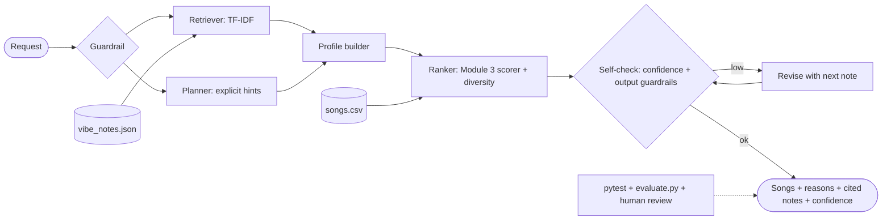

# VibeFinder 2.0: A Retrieval-Augmented, Self-Checking Music Recommender

Describe a vibe in plain English ("chill music for studying", "breakup, feeling sad and alone") and VibeFinder 2.0 retrieves matching notes from a small knowledge base, builds a taste profile from them, ranks a song catalog, checks its own confidence, and explains every recommendation with the notes it relied on.

**Why it matters:** real listeners do not think in `{"genre": "lofi", "energy": 0.35}`. They think in activities and feelings. This project closes that gap in a way that is transparent (every answer cites its sources and shows its math), testable (27 unit tests plus a 14-case evaluation harness), and honest about uncertainty (it warns instead of guessing silently).

---

## Base Project

This system extends my **Module 3 project, Music Recommender Simulation (VibeFinder 1.0)** ([original repo](https://github.com/noahdavis1019-ship-it/ai110-module3show-musicrecommendersimulation-starter)).

VibeFinder 1.0 was a content-based recommender that loaded a 20-song CSV, scored every song against a hand-written taste profile dictionary (genre, mood, target energy, acoustic preference), and printed the top 5 with a reason for every point awarded. It worked well for clean profiles but required the user to already know the catalog's exact genre and mood labels, and it had no way to tell when its answer was a bad fit.

## What Is New in 2.0

| Feature | Where | What it does |
|---|---|---|
| **Retrieval-Augmented Generation (RAG)** | `src/retriever.py`, `data/vibe_notes.json` | TF-IDF search over 19 "vibe notes" that link everyday language to musical attributes. The retrieved notes *become* the taste profile, so retrieval directly changes which songs are recommended, and the output cites the notes used. |
| **Agentic workflow** | `src/agent.py` | Guard, plan, retrieve, build profile, rank, self-check, and revise when confidence is low. Every step is recorded in a trace (`--trace`). |
| **Reliability system** | `src/agent.py`, `src/evaluate.py`, `tests/` | Confidence score (0 to 1) on every answer, output guardrails, 27 pytest tests, and an evaluation harness that writes a pass/fail table to `eval/results.md`. |
| **Guardrails and logging** | `src/guardrails.py`, `logs/` | Rejects empty, oversized, or wordless input with a friendly message, warns on low confidence or unknown genres, and logs every query, retrieval, and warning to `logs/vibefinder.log`. |
| **Artist diversity** | `src/agent.py` | Penalizes repeat artists so one artist cannot fill the list. |

The Module 3 scorer (`src/recommender.py`) and runner (`src/main.py`) are unchanged and still work; 2.0 builds on top of them.

---

## Architecture Overview

Diagram source: [`diagrams/architecture.mmd`](diagrams/architecture.mmd)



1. **Guardrail** validates the request (`validate_query`). Bad input stops here with a clear message.
2. **Planner** looks for explicit hints the user typed: a named genre (whole-word match, so "k-pop" is not read as "pop"), energy words like "hype" or "calm", and "acoustic".
3. **Retriever** ranks the 19 vibe notes by TF-IDF cosine similarity and keeps the top 3.
4. **Profile builder** takes genre and mood from the best note, blends energy and acoustic preference across all retrieved notes (weighted by similarity), then lets explicit hints override.
5. **Ranker** scores all 20 songs with the original Module 3 `score_song`, then subtracts 0.75 for each repeat of an artist.
6. **Self-check** computes confidence = retrieval strength x (0.6 x top-song fit + 0.4 x genre hit) and runs output guardrails (no duplicates, sorted, non-empty).
7. **Revise**: if confidence is under 0.45, the agent rebuilds the profile from the next-best note, re-checks, and keeps whichever result is better. Warnings are attached to the answer either way.
8. **Humans and tests** check the AI: pytest covers each component, `src/evaluate.py` runs 14 end-to-end cases, and I review the generated table and `--trace` output.

---

## Setup Instructions

Requires Python 3.9 or newer. No API keys and no network access are needed; everything runs locally with the standard library.

```bash
git clone https://github.com/noahdavis1019-ship-it/applied-ai-system-project.git
cd applied-ai-system-project
python -m venv .venv
source .venv/bin/activate        # Windows: .venv\Scripts\activate
pip install -r requirements.txt  # only pytest
```

Run it (always from the repo root):

```bash
python -m src.cli "chill music for studying"          # one request
python -m src.cli "gym playlist" --k 3 --trace         # fewer songs, show agent steps
python -m src.cli                                      # interactive mode, blank line quits
python -m pytest -q                                    # 27 unit tests
python -m src.evaluate                                 # 14-case eval, writes eval/results.md
python -m src.main                                     # original Module 3 runner
```

---

## Sample Interactions

Full reproducible transcripts (including `--trace` output, test runs, and a log excerpt) are in [`logs/sample_runs.md`](logs/sample_runs.md).

**1. Activity request, no genre named.** Retrieval maps "studying" to the lofi/focused note and "chill" to two calm notes; the artist penalty pushes the second LoRoom track down.

```text
$ python -m src.cli "chill music for studying"
Request: "chill music for studying"
Profile: genre=lofi, mood=focused, energy=0.37, acoustic=True
Based on: [n01] Studying and deep focus (matched: study); [n02] Late night wind down (matched: chill); [n07] Space and atmosphere (matched: chill)
Confidence: 0.98

1. Focus Flow by LoRoom [lofi, focused] score 4.84
   why: genre match (+2.0), mood match (+1.0), energy close to target (+1.46), acoustic fit (+0.39)
2. Library Rain by Paper Lanterns [lofi, chill] score 3.90
   why: genre match (+2.0), energy close to target (+1.47), acoustic fit (+0.43)
3. Midnight Coding by LoRoom [lofi, chill] score 3.03
   why: genre match (+2.0), energy close to target (+1.42), acoustic fit (+0.35), repeat artist (-0.75)
4. Coffee Shop Stories by Slow Stereo [jazz, relaxed] score 1.95
   why: energy close to target (+1.50), acoustic fit (+0.45)
5. Spacewalk Thoughts by Orbit Bloom [ambient, chill] score 1.82
   why: energy close to target (+1.36), acoustic fit (+0.46)
```

**2. High-energy request.**

```text
$ python -m src.cli "I need something for the gym" --k 3
Request: "I need something for the gym"
Profile: genre=pop, mood=intense, energy=0.92, acoustic=False
Based on: [n03] Workout and gym (matched: gym)
Confidence: 1.00

1. Gym Hero by Max Pulse [pop, intense] score 4.96
   why: genre match (+2.0), mood match (+1.0), energy close to target (+1.48), acoustic fit (+0.47)
2. Sunrise City by Neon Echo [pop, happy] score 3.76
   why: genre match (+2.0), energy close to target (+1.35), acoustic fit (+0.41)
3. Storm Runner by Voltline [rock, intense] score 2.94
   why: mood match (+1.0), energy close to target (+1.48), acoustic fit (+0.45)
```

**3. Genre the catalog does not have.** Version 1 of 2.0 silently matched "pop" inside "k-pop" with 0.97 confidence. Now it warns and lowers confidence.

```text
$ python -m src.cli "k-pop bangers" --k 3
Request: "k-pop bangers"
Profile: genre=k-pop, mood=happy, energy=0.8, acoustic=False
Based on: [n19] Indie pop brightness (matched: pop); [n04] Feel good sunshine (matched: pop); [n03] Workout and gym (matched: pop)
Confidence: 0.35

1. Sunrise City by Neon Echo [pop, happy] score 2.88
   why: mood match (+1.0), energy close to target (+1.47), acoustic fit (+0.41)
2. Rooftop Lights by Indigo Parade [indie pop, happy] score 2.77
   why: mood match (+1.0), energy close to target (+1.44), acoustic fit (+0.33)
3. Concrete Crown by Blockwise [hip hop, confident] score 1.91
   why: energy close to target (+1.47), acoustic fit (+0.44)
WARNING: Low confidence (0.35). Results may not match what you meant.
WARNING: Genre 'k-pop' is not in the catalog.
```

**4. Guardrails: gibberish and empty input.**

```text
$ python -m src.cli "asdf qwerty" --k 3
Request: "asdf qwerty"
Profile: genre=None, mood=None, energy=0.5, acoustic=False
Confidence: 0.00
...
WARNING: No vibe notes matched; showing a neutral mid-energy mix. Try naming an activity, mood or genre.
WARNING: Low confidence (0.00). Results may not match what you meant.

$ python -m src.cli ""
Sorry, I can't run that request: Request is empty. Try something like 'chill music for studying'.
```

---

## Design Decisions and Trade-offs

- **TF-IDF retrieval instead of an LLM or embeddings.** It runs offline with no API key, is fully reproducible for graders, and every match is explainable ("matched: gym"). The trade-off is that it only understands words that appear in the notes; "quiet piano" finds weak matches and synonyms like "lifting weights" only work because I wrote "lifting" into a note.
- **Retrieval builds the profile instead of being printed next to it.** The retrieved notes set genre, mood, energy, and acoustic preference, so changing the knowledge base changes the recommendations. This keeps RAG load-bearing rather than decorative.
- **Reused the Module 3 scorer unchanged.** The scoring rules were already tested and explainable, so the new layers wrap them instead of replacing them. The downside is that its known biases (genre worth 2 points, exact string matching) carry over.
- **Explicit words beat retrieval.** If a user types "rock for studying", they get rock. Users know what they asked for better than a similarity score does.
- **Retrieval-gated confidence.** My first formula averaged retrieval and song fit, which gave 0.70 confidence to weak queries because the scorer can always find a song that fits a guessed profile. Multiplying by retrieval strength means a weak understanding of the request cannot produce a confident answer.
- **Warn instead of refuse for low confidence.** The system still returns songs but labels them, which is more useful than an error and more honest than silence.
- **One revision attempt, not a loop.** Bounded, predictable, and easy to test. In practice the revision rarely wins, because the next-best note is usually weaker; it mainly documents that the agent checked.

---

## Testing Summary

- **Unit tests:** 27 out of 27 pass (`python -m pytest -q`): 5 original Module 3 tests plus 22 new tests covering tokenizing, retrieval, every guardrail, whole-word genre matching, retrieval changing the profile, explicit-hint override, trace completeness, artist diversity, confidence behavior, and the revise step.
- **Evaluation harness:** 14 out of 14 cases pass (`python -m src.evaluate`, table in [`eval/results.md`](eval/results.md)). Average confidence is 0.94 on in-catalog requests and drops to 0.00 to 0.35 on gibberish, vague, or out-of-catalog requests, which is the behavior I wanted.
- **What did not work at first:** the first eval run was 13 out of 14. "k-pop bangers" failed because substring matching read it as "pop" and reported 0.97 confidence with no warning. Adding whole-word matching and a list of known missing genres fixed it. Separately, my first confidence formula was too generous on weak queries (0.70 for "quiet piano"); gating by retrieval strength dropped that to 0.40 and triggered a warning plus a revision attempt.
- **What I learned:** a high score from the ranker does not mean the system understood the request. Confidence has to measure understanding (retrieval), not just fit.
- **Human review:** I read every row of `eval/results.md` and the `--trace` output for each sample to confirm the cited notes actually justify the songs returned.

---

## Reflection

The biggest lesson was that the most dangerous output is a confident wrong answer. VibeFinder 1.0 always produced a tidy top 5, and the first draft of 2.0 did too, even for "k-pop" and "quiet piano". Adding retrieval made the system more useful, but adding the self-check and evaluation harness is what made it trustworthy, because it forced me to define what a good answer looks like before judging one. I also learned that small, explainable components (a 100-line retriever, a 3-line confidence formula) are easier to test and defend than a bigger model I cannot inspect.

My responsible-AI reflection, AI collaboration notes, and limitations are in [`model_card.md`](model_card.md).

---

## Repo Layout

```text
src/
  agent.py        VibeAgent: plan, retrieve, profile, rank, check, revise
  retriever.py    TF-IDF retriever over the vibe notes
  guardrails.py   input validation, energy clamping, output checks
  cli.py          command line interface and logging setup
  evaluate.py     reliability harness -> eval/results.md
  recommender.py  Module 3 scorer (unchanged)
  main.py         Module 3 runner (unchanged)
data/
  songs.csv       20-song catalog
  vibe_notes.json 19-note knowledge base
diagrams/architecture.mmd   system diagram (Mermaid source)
assets/                     supplementary images
eval/                       eval cases and generated results table
logs/sample_runs.md         reproducible command output
tests/                      pytest suites
model_card.md               reflection, ethics, limitations
```
